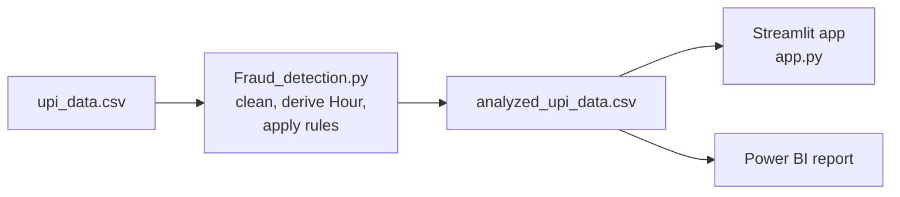

# UPI Fraud Alerts System

A rule-based fraud detection pipeline and dashboard for UPI transactions. It flags suspicious payments using two explainable rules (amount outliers and odd-hour activity) and presents the alerts in an interactive Streamlit app and a Power BI report. All amounts are shown in the Indian numbering system (lakh and crore).

**Tech stack:** Python, Pandas, Streamlit, Plotly, Power BI

---

## At a glance

| Metric | Value |
|---|---|
| Transactions analysed | 5,000 (Jan to Dec 2023, 10 Indian cities) |
| Total transaction value | ₹ 8.96 crore (₹ 8,95,88,322) |
| Transactions flagged | 250 (5.0%) |
| Value at risk | ₹ 6.57 crore, which is 73.3% of total value |
| Average flagged payment | ₹ 2.63 lakh, about 52 times the average normal payment (₹ 5,028) |
| Detection threshold | Any amount above ₹ 15,931 (Q3 + 1.5 × IQR) |

---

## 1. Problem

UPI handles a huge volume of small, fast payments, which makes manual review impossible. A fraud analyst needs a short, prioritised list of suspicious transactions with a clear reason for each one, not a black-box score.

The goal of this project was to answer three questions:

1. Which transactions look abnormal, and why?
2. How much money is exposed in those transactions?
3. When and where do the suspicious transactions happen?

## 2. Data

The dataset (`upi_data.csv`) holds 5,000 anonymised, simulated UPI transactions with these fields:

| Column | Description |
|---|---|
| `Transaction_ID` | Unique UPI transaction reference |
| `Timestamp` | Date and time of the payment |
| `Sender`, `Receiver` | Anonymised user IDs |
| `Amount` | Payment amount in ₹ |
| `Location` | City (Delhi, Mumbai, Bangalore, Chennai, Hyderabad, Kolkata, Pune, Ahmedabad, Jaipur, Lucknow) |

The data has no missing values and no duplicate transaction IDs. It has no confirmed fraud labels, which is why an unsupervised, rule-based approach was used instead of a trained classifier.

## 3. Approach



1. **Clean:** parse timestamps, convert amounts to numbers, drop invalid rows and duplicate IDs.
2. **Engineer features:** extract the hour of each transaction.
3. **Apply rules:** score each transaction against the two rules below.
4. **Visualise:** feed the scored file into the Streamlit dashboard and the Power BI report.

## 4. Detection rules

**Rule 1: Amount outlier (IQR method).** Q1 = ₹ 2,660 and Q3 = ₹ 7,968, so the upper fence is Q3 + 1.5 × IQR = ₹ 15,931. Any payment above this is unusually large for this population. IQR was chosen over mean and standard deviation because transaction amounts are heavily skewed, and IQR is not pulled upward by the very outliers it is trying to catch.

**Rule 2: Odd hour.** Payments made between 12:00 AM and 4:59 AM, when genuine activity is lowest.

| Fraud_Flag | Condition |
|---|---|
| High Risk (Amount Outlier) | Rule 1 fires (with or without Rule 2) |
| Medium Risk (Odd Hour) | Only Rule 2 fires |
| Safe | Neither rule fires |

Each transaction also gets a `Risk_Score` (0 to 2, the number of rules that fired) and a `Risk_Reason` (for example, *High amount + Odd hour*), so every alert can be explained in one line.

## 5. Key findings

- **5% of transactions carry 73% of the money.** The 250 flagged payments are worth ₹ 6.57 crore out of ₹ 8.96 crore. Reviewing just these would cover most of the financial exposure.
- **Both signals point to the same transactions.** Every one of the 250 high-value outliers happened between 1 AM and 5 AM, and no normal-sized payment occurred in that window. Two independent rules agreeing makes these alerts much more credible.
- **Flagged amounts are far from normal.** Flagged payments range from ₹ 50,138 to ₹ 4,98,076, while 75% of all payments are below ₹ 7,968.
- **Chennai, Hyderabad and Kolkata lead in alerts** with 33, 31 and 28 flagged transactions. Chennai also has the highest total transaction value at ₹ 1.24 crore.
- **Volume is steady across months** (about 390 to 450 transactions per month), so the alerts are not explained by a seasonal spike.

## 6. Dashboard

### Streamlit app (`app.py`)

- **KPI cards:** total transactions, total value, flagged transactions with fraud rate, and value at risk, all in lakh and crore with the exact rupee figure on hover.
- **Filters:** risk level, city, and date range.
- **Risk category donut** showing the share of Safe, Medium and High risk.
- **Hourly trend** of transaction value with the odd-hour window highlighted.
- **City-wise alerts** bar chart with value at risk on hover.
- **Monthly transaction value** split by risk level.
- **Flagged transactions table** sorted by amount, with the reason for each alert and a CSV download for investigators.
- **"How the detection works"** panel showing the live IQR threshold.

### Power BI report (`power BI.pbix`)

A one-page report on the same `analyzed_upi_data.csv` with a risk-level slicer, a donut chart of fraud categories, and an hourly amount trend line.

## 7. Improvements in v2

| Area | Before | After |
|---|---|---|
| Currency format | International grouping (₹ 89,588,322 and "M" on chart axes) | Indian system (₹ 8,95,88,322, ₹ 8.96 Cr, axes in ₹ lakh) |
| Rule logic | The amount rule ran first, so the odd-hour signal was hidden and "Medium Risk" never appeared even though all outliers were at odd hours | Each rule is evaluated separately; `Risk_Score` and `Risk_Reason` record every rule that fired |
| Odd-hour window | 2 AM to 4:59 AM | 12 AM to 4:59 AM (configurable in one constant) |
| Performance | Row-by-row `df.apply` | Vectorised Pandas operations |
| Dashboard | 2 KPIs, 1 filter, 2 charts | 4 KPIs, 3 filters, 4 charts, alert table with CSV export |
| Code | Mixed-language comments | Documented, English comments, pinned dependency versions |

The original `Fraud_Flag` labels are unchanged, so the Power BI report continues to work. New columns are added at the end of the CSV.

## 8. Limitations and next steps

- **Static thresholds.** One IQR fence is applied to everyone. A per-sender baseline (for example, a payment 10 times larger than the sender's usual amount) would catch fraud on smaller accounts.
- **No velocity check.** Many payments from one sender within a few minutes is a classic fraud pattern that is not yet covered.
- **No labels.** With confirmed fraud labels, the rule output could be validated with precision and recall, and a model such as Isolation Forest or XGBoost could be compared against the rules.
- **Batch, not real time.** In production, the same rules could run on a stream (for example, Kafka) and send alerts as payments happen.

## How to run

```bash
pip install -r requirements.txt

# 1. Score the raw data (creates analyzed_upi_data.csv)
python Fraud_detection.py

# 2. Launch the dashboard
streamlit run app.py
```

Open `power BI.pbix` in Power BI Desktop and refresh to load the latest `analyzed_upi_data.csv`.

## Project structure

```
├── upi_data.csv               # Raw transactions (input)
├── Fraud_detection.py         # Cleaning + rule-based detection
├── analyzed_upi_data.csv      # Scored output (Fraud_Flag, Risk_Score, Risk_Reason)
├── app.py                     # Streamlit dashboard
├── power BI.pbix              # Power BI report
├── requirements.txt
└── README.md
```
